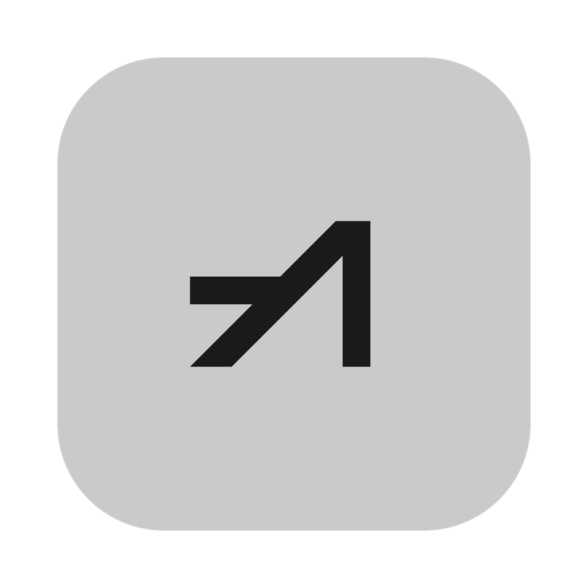
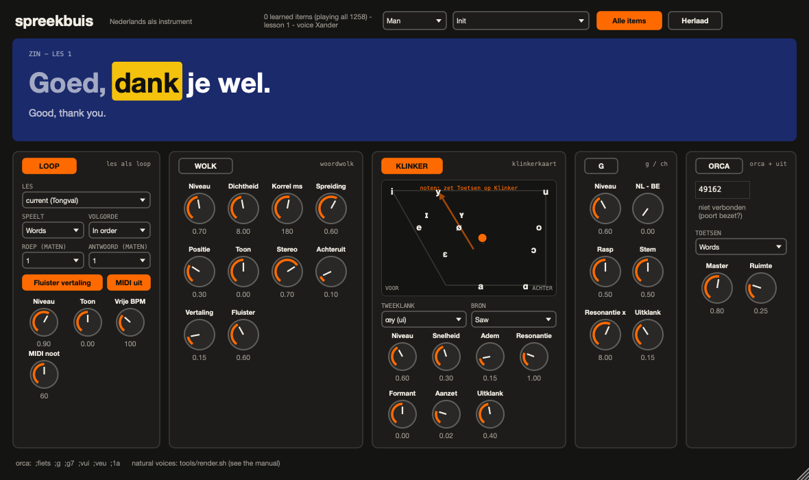
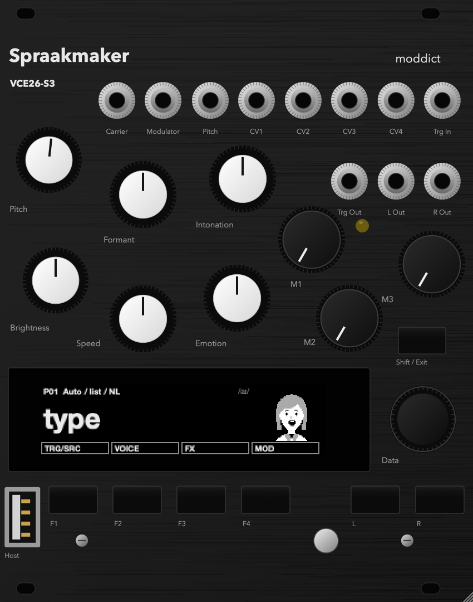

&nbsp;&nbsp;&nbsp;

# spreek

Two Dutch speech instruments in one bundle, VST3 / AU / standalone for macOS, Windows and Linux:

- **spreekbuis** — Dutch as an instrument: the words and sentences of the Tongval course as a tempo-synced lesson loop
  (call and response, karaoke, a MIDI note per word), a granular word cloud with whispered English glosses, a formant pad
  whose XY chart is the Dutch vowel chart, a g/ch generator, and an Orca UDP bridge.
- **spraakmaker** — a speech computer: an 80s-style Klatt formant synthesizer that turns text into English or Dutch speech
  (CMUdict English, rule-based Dutch), with CLASSIC / VOCODER / VOSINGER modes, microtonal tunings, a pixel tutor on the
  OLED and 100 presets. An homage **after the Phonemer by moddict** (a Eurorack module): the layout follows the module, the
  code, the voice and the Dutch are original, and no moddict names or marks are used on the panel. Not affiliated with moddict.

**Install (macOS):** `brew tap femifleming/tap && brew install --cask femifleming/tap/spreekbuis femifleming/tap/spraakmaker` —
or download `spreek-macOS.zip`, `spreek-Windows.zip` or `spreek-Linux.tar.gz` from the
[releases](https://github.com/femifleming/spreek/releases) (both plug-ins, the apps and the manuals in every download).
**Neural Dutch voices for Spreekbuis** (needs Python 3): `python3 Spreekbuis/tools/render.py --setup-piper` once (any OS: installs
[Piper](https://github.com/rhasspy/piper) and the pim / nathalie / lessac voices) and, on an Apple Silicon Mac, `--setup-voxtral`
(Voxtral-4B-TTS, the best Dutch, ~2.5 GB); then `Spreekbuis/tools/render.sh` (and `--female`) to record the course; see *The voice* below.

**Manuals:** [Spreekbuis Manual.pdf](docs/Spreekbuis%20Manual.pdf) · [Spraakmaker Manual.pdf](docs/Spraakmaker%20Manual.pdf)
(sources: `spreekbuis/docs/manual.html`, `spraakmaker/docs/manual.html`; `scripts/manuals.sh` re-prints them with Chrome).

## spreekbuis

Layers, mixed freely: **Loop** (the lesson as call & response, with the English whispered in the answer bars and a MIDI out
note at every word onset), **Wolk** (a granular cloud of the words you know, plus translation grains through a 12-band noise
vocoder), **Klinker** (a formant filter steered by the Dutch vowel chart i y u ɪ ʏ e ø o ə ɔ ɛ a ɑ with the diphthong glides
ɛi, œy, ʌu; sources saw, noise, the input, or the loop and the cloud heard through it), **Stem** (man / woman), **G** (the Dutch
g/ch, hard Holland /x/ to soft Flemish /ɣ/), **Orca** (UDP on 127.0.0.1:49162: `;fiets` speaks a word, `;g7` fires the g,
`;vui` hits a vowel) and **Toetsen** (MIDI notes play words, the vowel, the g or everything).

**The voice.** Spreekbuis plays recorded audio of every course item. Render that voice bank once with
`spreekbuis/tools/render.sh` (`--female` for the woman's bank, `--force` to redo everything). Engines, best first:

| | engine | voices |
|---|---|---|
| macOS (Apple Silicon) | **Voxtral-4B-TTS** (Mistral, 2026: a speech language model with native Dutch voices, 24 kHz, run locally with [mlx-audio](https://github.com/Blaizzy/mlx-audio); `python3 tools/render.py --setup-voxtral` makes the venv and fetches `mlx-community/Voxtral-4B-TTS-2603-mlx-4bit`, ~2.5 GB; the Tongval install is reused). About an hour for both banks (RTF ~0.8) | `nl_male` (the man), `nl_female` (the woman); the English glosses come from Piper |
| all | **Piper** neural voices (`python3 tools/render.py --setup-piper`: a venv with `piper-tts` plus the voices from [rhasspy/piper-voices](https://huggingface.co/rhasspy/piper-voices), ~200 MB, into the data folder; an existing install is reused: `PIPER_PYTHON`, `PIPER_VOICES`, the Tongval venv, a `piper` binary) | `nl_NL-pim-medium` (the man), `nl_BE-nathalie-medium` (the woman), `en_US-lessac-medium` for the English glosses |
| macOS | `tools/render.swift` (AVSpeechSynthesizer, exact word onsets) | the best installed Apple Dutch voice: Premium, then Enhanced, then compact. Install better ones in System Settings → Accessibility → Spoken Content → Manage Voices → Dutch (Xander Enhanced, Claire Premium) |
| Windows | `python tools\render.py` (System.Speech / SAPI) | an installed Dutch voice (Settings → Time & language → Speech → Manage voices) |
| Linux | `python3 tools/render.py` | `espeak-ng -v nl` |

Without a rendered bank the plug-in is never silent: it speaks every item with the **built-in formant voice** it shares with
Spraakmaker (made once into `voice-builtin/` on first use). Data folder: `~/Library/Application Support/Spreekbuis` (macOS),
`%APPDATA%\Spreekbuis` (Windows), `~/.config/Spreekbuis` (Linux). On the Mac that has Tongval, only the items you have learned
are offered (plus the current lesson) and plays are logged for Tongval; elsewhere **Alle items** plays the whole course.

## spraakmaker

Knobs Pitch / Formant / Intonation / Brightness / Speed / Emotion and three macros; Data encoder (turn = edit or browse
presets, push = load or trigger, Shift + push = save); F1–F4 pages TRG/SRC · VOICE · FX · MOD on the OLED; the round button
triggers; type on the computer keyboard and press Enter to make it say that. Jacks map to side-chain inputs (carrier,
modulator), MIDI notes (pitch, trigger in), MIDI out (word / phoneme triggers) and four modulation slots. Sources DICT, ALPHA,
KEYB, MARKOV, LETTR and 99 editable LISTs; triggers AUTO (tempo-synced or free), TRIG, GATE, PH.TRG, PH.GATE; engines
CLASSIC (up to 4 voices), VOCODER (own carriers or the side-chain), VOSINGER (chords); tunings EQUAL / JUST / PYTHAG /
MEANTN / 24-TET / a Scala `.scl`; bitcrush, width, ping-pong delay, reverb.

## Build

    cmake -B build -G Ninja -DCMAKE_BUILD_TYPE=Release        # JUCE 9.0.5: ./JUCE, JUCE_DIR, ~/disting-ex-plugins/JUCE, or fetched
    cmake --build build --target spreek_all                   # Spreekbuis + Spraakmaker (VST3, Standalone; AU on macOS)
    cmake --build build --target SBTest SpraakTest SpraakFull SpraakShot SpreekHostCheck   # the tests (see .github/workflows/build.yml)

`-DSPREEK_COPY_AFTER_BUILD=ON` installs the plug-ins into the user plug-in folders; macOS universal builds add
`-DCMAKE_OSX_ARCHITECTURES="arm64;x86_64"`. Linux needs the usual JUCE packages (see the workflow). Windows: Visual Studio 2022.
The shared speech code (text → phonemes, prosody, the Klatt voice) is in `common/`; the English dictionary is CMUdict
(`common/data/LICENSE.cmudict`).

## Licence

AGPL-3.0 (see LICENSE). CMUdict is BSD-licensed. Spraakmaker is an independent homage after the Phonemer by moddict; it is not
affiliated with, endorsed by or a product of moddict.
