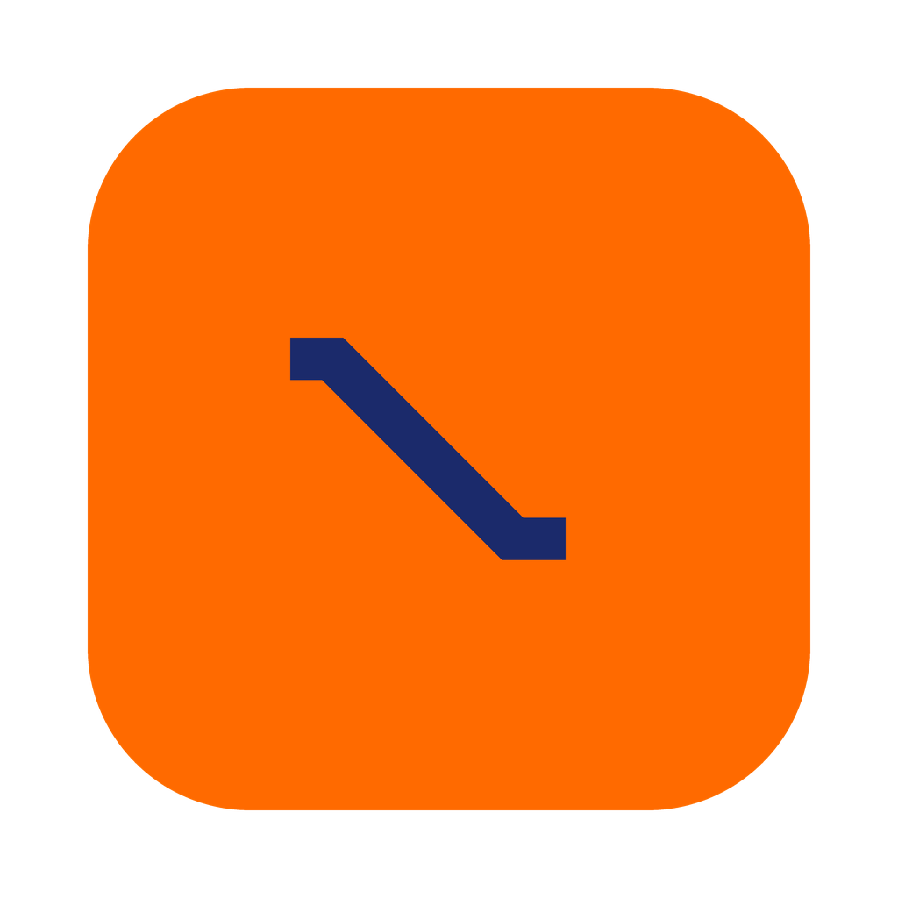
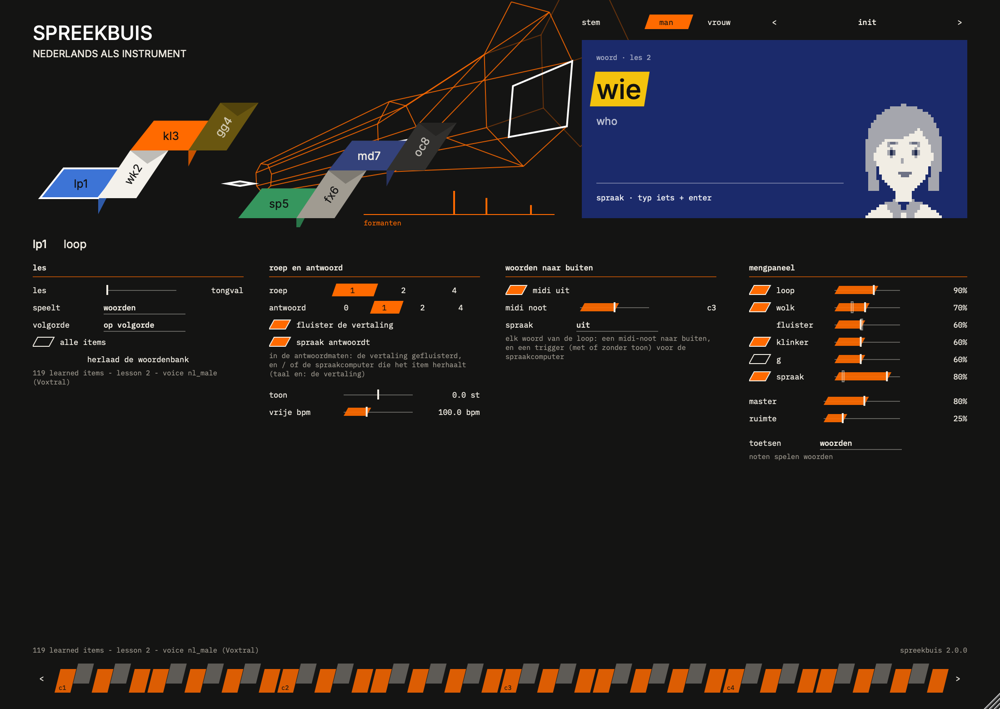

# spreek

**Spreekbuis** — Dutch as an instrument, with a speech computer inside. One plug-in (VST3 / VST2 / AU / standalone) for
macOS, Windows and Linux.

Until 1.0 this repository shipped two plug-ins, Spreekbuis and Spraakmaker. Since **2.0** they are one instrument in the
design language of the faltung suite, in Spreekbuis's colours (dark field, orange, navy, karaoke yellow). Its layers, each
a page of the window, mixed freely from one mixer:

- **loop** (lp1) — the Tongval lesson as tempo-synced call and response: karaoke, the English whispered in the answer bars,
  a MIDI out note at every word onset.
- **wolk** (wk2) — a granular cloud of the words you know, plus translation grains through a 12-band noise vocoder.
- **klinker** (kl3) — a formant filter steered by the Dutch vowel chart (i y u ɪ ʏ e ø o ə ɔ ɛ a ɑ, the glides ɛi œy ʌu);
  sources saw, noise, the input — or the loop, the cloud, the speech computer or all of them heard through it.
- **g** (gg4) — the Dutch g/ch, hard Holland /x/ to soft Flemish /ɣ/.
- **spraak** (sp5) — the speech computer (Spraakmaker 1.0): an 80s-style Klatt formant synthesizer that turns text into
  Dutch or English speech (CMUdict English, rule-based Dutch); sources dict, alpha, keyb, markov, lettr, 99 lists and **les**
  (the word bank); triggers auto / trig / gate / ph.trg / ph.gate; engines classic (up to 4 voices), vocoder, vosinger
  (chords); tunings equal / just / pythag / meantn / 24-tet / Scala; Sanne, the pixel tutor, mouths the phonemes.
- **fx** (fx6) — bitcrush, width, ping-pong echo, reverb: on the speech computer, or on everything.
- **mod** (md7) — four LFOs, four matrix slots, three macros; sources include every word the bank says, the layers'
  loudness and the vowel chart; destinations every layer.
- **orca** (oc8) — UDP on 127.0.0.1:49162: `;fiets` speaks a word, `;g7` fires the g, `;vui` hits a vowel,
  `;=hallo_jij` makes the speech computer say it, `;!` triggers it.

They work on each other: one voice switch (man / vrouw) for the recorded words, the vowel chart and the speech computer; one
clock; the speech computer can **answer the loop** (it repeats each item in the answer bars, or says its English), the
loop's **word onsets trigger** it (with or without their notes), it can **read the lesson** (source les), the vocoder can
**listen to the bank's voice** (vosinger sings the lesson in chords), and the keys can play any layer or all of them.

**Old sessions.** Spreekbuis 2.0 keeps Spreekbuis 1.0's plug-in and parameter IDs, so 1.0 sessions open unchanged.
Spraakmaker 1.0 states, preset slots and host preset files (.vstpreset, .aupreset, .fxp) import into the speech computer
(preset menu → *open of importeer*). Spraakmaker 1.0 itself is no longer built; its last release is
[v1.0.0](https://github.com/femifleming/spreek/releases/tag/v1.0.0).

**Install (macOS):** `brew tap femifleming/tap && brew install --cask femifleming/tap/spreekbuis` — or download
`spreek-macOS.zip`, `spreek-Windows.zip` or `spreek-Linux.tar.gz` from the
[releases](https://github.com/femifleming/spreek/releases) (the plug-in in every format, the app, the manual and the voice tools).

**Manual:** [Spreekbuis Manual.pdf](docs/Spreekbuis%20Manual.pdf) (source `docs/manual.html`; `scripts/manuals.sh` re-prints it with Chrome).
Before / after: `docs/img/before/` (1.0's two windows), `docs/img/after/` (every page of 2.0).

**The voice.** Spreekbuis plays recorded audio of every course item. Render that voice bank once with
`tools/render.sh` (`--female` for the woman's bank, `--force` to redo everything). Engines, best first:

| | engine | voices |
|---|---|---|
| macOS (Apple Silicon) | **Voxtral-4B-TTS** (Mistral, 2026: a speech language model with native Dutch voices, 24 kHz, run locally with [mlx-audio](https://github.com/Blaizzy/mlx-audio); `python3 tools/render.py --setup-voxtral` makes the venv and fetches `mlx-community/Voxtral-4B-TTS-2603-mlx-4bit`, ~2.5 GB; the Tongval install is reused). About an hour for both banks (RTF ~0.8) | `nl_male` (the man), `nl_female` (the woman); the English glosses come from Piper |
| all | **Piper** neural voices (`python3 tools/render.py --setup-piper`: a venv with `piper-tts` plus the voices from [rhasspy/piper-voices](https://huggingface.co/rhasspy/piper-voices), ~200 MB, into the data folder; an existing install is reused: `PIPER_PYTHON`, `PIPER_VOICES`, the Tongval venv, a `piper` binary) | `nl_NL-pim-medium` (the man), `nl_BE-nathalie-medium` (the woman), `en_US-lessac-medium` for the English glosses |
| macOS | `tools/render.swift` (AVSpeechSynthesizer, exact word onsets) | the best installed Apple Dutch voice: Premium, then Enhanced, then compact. Install better ones in System Settings → Accessibility → Spoken Content → Manage Voices → Dutch (Xander Enhanced, Claire Premium) |
| Windows | `python tools\render.py` (System.Speech / SAPI) | an installed Dutch voice (Settings → Time & language → Speech → Manage voices) |
| Linux | `python3 tools/render.py` | `espeak-ng -v nl` |

Every clip is levelled to the same speech loudness (−16 dBFS) whatever the engine, so the layers balance the same with every voice.
Without a rendered bank the plug-in is never silent: it speaks every item with the **built-in formant voice** that is also
its speech computer (made once into `voice-builtin/` on first use). Data folder: `~/Library/Application Support/Spreekbuis` (macOS),
`%APPDATA%\Spreekbuis` (Windows), `~/.config/Spreekbuis` (Linux). On the Mac that has Tongval, only the items you have learned
are offered (plus the current lesson) and plays are logged for Tongval; elsewhere **Alle items** plays the whole course.

## Build

    cmake -B build -G Ninja -DCMAKE_BUILD_TYPE=Release        # JUCE 9.0.5: ./JUCE, JUCE_DIR, ~/disting-ex-plugins/JUCE, or fetched
    cmake --build build --target Spreekbuis_All               # VST3, VST2, Standalone; AU on macOS
    cmake --build build --target SBTest SpraakTest SpraakFull SpreekTest SpreekHostCheck   # the tests (see .github/workflows/build.yml)

`SBTest` checks the word bank's layers, `SpraakFull` the speech computer feature by feature, `SpreekTest` what joins them,
Spreekbuis 1.0 / Spraakmaker 1.0 states (`tests/fixtures`), the state round trip, defaults, stereo and the play log
(`SpreekTest --shots <dir>` draws every page), `SpreekHostCheck` loads the built VST3 / VST2 / AU like a DAW.
`-DSPREEK_COPY_AFTER_BUILD=ON` installs the plug-in into the user plug-in folders; macOS universal builds add
`-DCMAKE_OSX_ARCHITECTURES="arm64;x86_64"`. VST2 is built with the FST headers (`third_party/vst2-fst`; `-DSPREEK_BUILD_VST2=OFF`
to skip). Linux needs the usual JUCE packages (see the workflow). Windows: Visual Studio 2022. The speech code (text →
phonemes, prosody, the Klatt voice) is in `common/`; the English dictionary is CMUdict (`common/data/LICENSE.cmudict`).

## Licence

AGPL-3.0 (see LICENSE). CMUdict is BSD-licensed. Inter and IBM Plex Mono: SIL Open Font Licence (`Resources/fonts`). FST
(VST2 headers): see `third_party/vst2-fst`. The speech computer is an independent homage after the Phonemer by moddict; it is
not affiliated with, endorsed by or a product of moddict.
