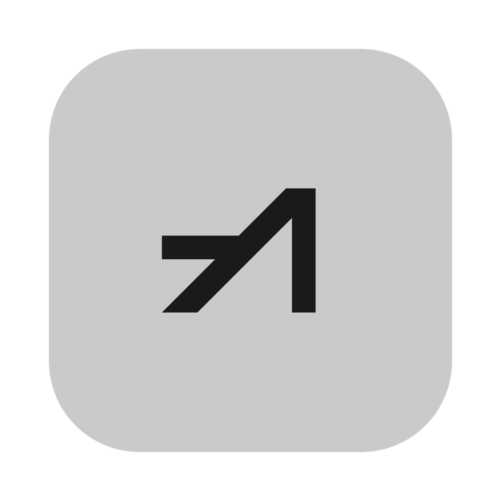

# spraakmaker

A speech computer as a VST3 / AU / standalone instrument (dark panel edition) that speaks **English and Dutch**. An
independent homage after the Phonemer by moddict (a Eurorack module): the layout follows the module, everything else is
original, and no moddict names or marks appear on the panel. Not affiliated with moddict. Part of the
[spreek](../README.md) bundle; the manual is [here](../docs/Spraakmaker%20Manual.pdf) (source: `docs/manual.html`).

## How it talks
- **Text → phonemes** (`../common/G2P.cpp`): English via the CMU Pronouncing Dictionary (126k words) plus letter rules for
  unknown words; Dutch via a rule-based converter (open/closed syllables, digraphs ui/eu/ij/ei/ou/oe/ie, sch/ch/g, schwa,
  -lijk/-ig, n-deletion, final devoicing, prefix and suffix stress).
- **Prosody** (`../common/Planner.cpp`): stress lengthening, phrase-final lengthening, accents, declination, question rise.
- **Synth** (`../common/Voice.cpp`): Klatt-style formant synthesizer — KLGLOTT88 glottal source with jitter / shimmer /
  breath, cascade F1–F5, nasal pole/zero, parallel frication and bursts, coarticulated transitions, unaspirated Dutch stops,
  uvular ʀ trill. Shared with Spreekbuis's built-in voice.

## Panel → plug-in
Knobs Pitch / Formant / Intonation / Brightness / Speed / Emotion, M1–M3 macros (destinations on the MOD page), Data encoder
(turn = edit / browse presets, push = load / trigger, Shift + push = save preset), F1–F4 = TRG/SRC · VOICE · FX · MOD pages,
L/R = select, Shift/Exit, round button = trigger. Jacks: Carrier / Modulator = side-chain inputs 1 / 2, Pitch + Trg In = MIDI
notes, Trg Out = MIDI notes 60 (word) / 62 (phoneme), CV1–CV4 = modulation slots (KNOB / LFO1–4 / VEL / MODWH / RAND → dest).
USB Host = type on the computer keyboard, Enter speaks it. Shift+F1 edits the current list, Shift+F2 loads a Scala .scl tuning.

Modes CLASSIC / VOCODER / VOSINGER (4-voice poly, 10 chord memories, fine detune); triggers AUTO (tempo-synced or free), TRIG,
GATE, PH.TRG, PH.GATE, retrigger; sources DICT, ALPHA, KEYB, MARKOV (Alice in Wonderland / Tongval Dutch sentences), LETTR
(sound poetry), LIST (99 lists); tunings EQUAL / JUST / PYTHAG / MEANTN / 24-TET / USER .scl; FX bitcrush, width, ping-pong
delay, reverb. 100 preset slots (20 factory). Lists and presets live in the data folder: `~/Library/Application
Support/Spraakmaker` (macOS), `%APPDATA%\Spraakmaker` (Windows), `~/.config/Spraakmaker` (Linux).

## Tests
    SpraakTest <outdir>     # G2P coverage + renders to WAV
    SpraakShot <outdir>     # all presets + UI snapshots (the manual's images)
    SpraakFull              # every feature, one by one (110 checks)
