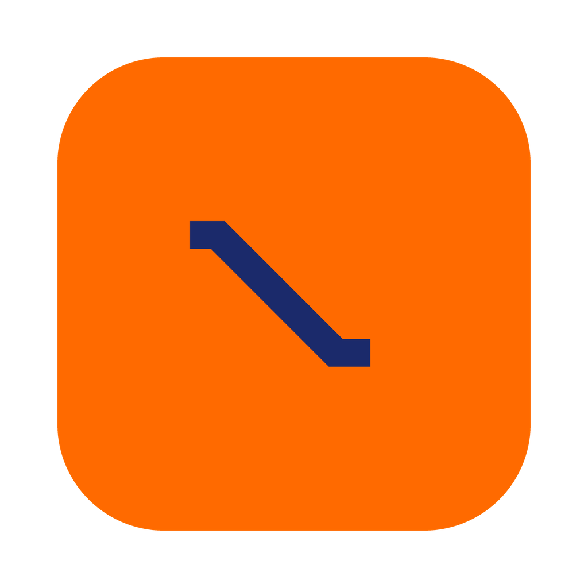

# spreekbuis

Dutch as an instrument: a VST3 / AU / standalone instrument that plays the words and sentences of the Tongval Dutch
course, so practising Dutch and making experimental music become the same thing. Part of the
[spreek](../README.md) bundle; the full description, installation and the voice rendering are in the root README, the
details in [the manual](../docs/Spreekbuis%20Manual.pdf) (source: `docs/manual.html`).

- `Source/` — the plug-in (Bank: the voice bank and Tongval's progress; Dsp: filters, grains, whisperizer, vowel chart,
  g; PluginProcessor / PluginEditor).
- `tools/` — `render.sh` renders the voice bank: `render.swift` on macOS (AVSpeech, exact word onsets), `render.py` on
  Windows (SAPI) and Linux (piper / espeak-ng); `export_items.js` exports Tongval's live word lists when Tongval is here.
- `data/items.json` — the course items (Dutch, English gloss, lesson), also compiled into the plug-in for the built-in
  Klatt voice (`../common/`) that speaks when no bank has been rendered.
- `tests/SBTest.cpp` — renders every layer offline and checks it is audible and finite; also the real Orca UDP socket.

Plays are logged to `plays.json` in the data folder (`~/Library/Application Support/Spreekbuis` on macOS); Tongval reads it
at launch and shows ♪ counts and listening XP.
